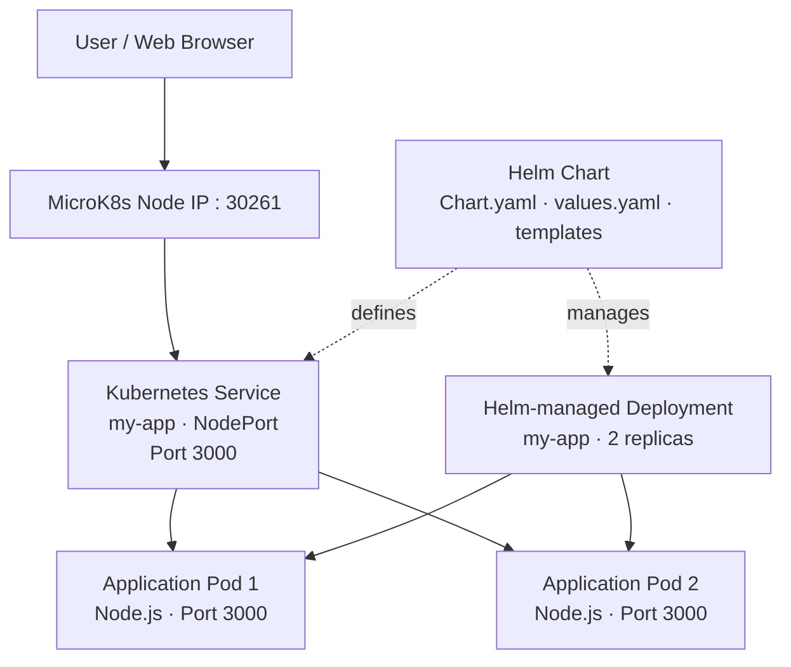

# Helm-Based Node.js Application on MicroK8s

A hands-on Kubernetes deployment project demonstrating how to package, deploy, expose, and manage a containerized Node.js application using **Helm 3 and MicroK8s**.

The project deploys a Node.js application with two replicas and exposes it through a Kubernetes NodePort Service.

## Architecture



## Technology Stack

- **Kubernetes:** MicroK8s
- **Package manager:** Helm 3
- **Container runtime / image distribution:** Docker and Docker Hub
- **Application:** Node.js container
- **Workload management:** Kubernetes Deployment
- **Networking:** Kubernetes NodePort Service
- **Image:** `abdulkadirabdikarin/node-app:latest`

## Project Configuration

| Component | Configuration |
|---|---|
| Helm release | `my-app` |
| Namespace | `default` |
| Chart version | `0.1.0` |
| Replicas | 2 |
| Container port | 3000 |
| Service type | NodePort |
| NodePort | 30261 |

## Features Demonstrated

- Packaging Kubernetes resources into a reusable Helm chart
- Deploying and upgrading applications with Helm
- Running multiple application replicas
- Exposing workloads through a Kubernetes Service
- Rendering Kubernetes manifests before deployment
- Validating chart structure with `helm lint`
- Inspecting pods, deployments, services, endpoints, and application logs
- Managing release revisions and rollbacks

## Prerequisites

- Linux or another supported operating system
- A running MicroK8s cluster
- `kubectl`
- Helm 3, available as `microk8s helm3` in this environment
- Access to pull the application container image

Verify the environment:

```bash
microk8s status --wait-ready
microk8s kubectl get nodes
microk8s helm3 version
```

## Installation and Deployment

Run these commands from the directory containing `Chart.yaml`.

### 1. Validate the chart

```bash
microk8s helm3 lint .
```

### 2. Preview Kubernetes manifests

```bash
microk8s helm3 template